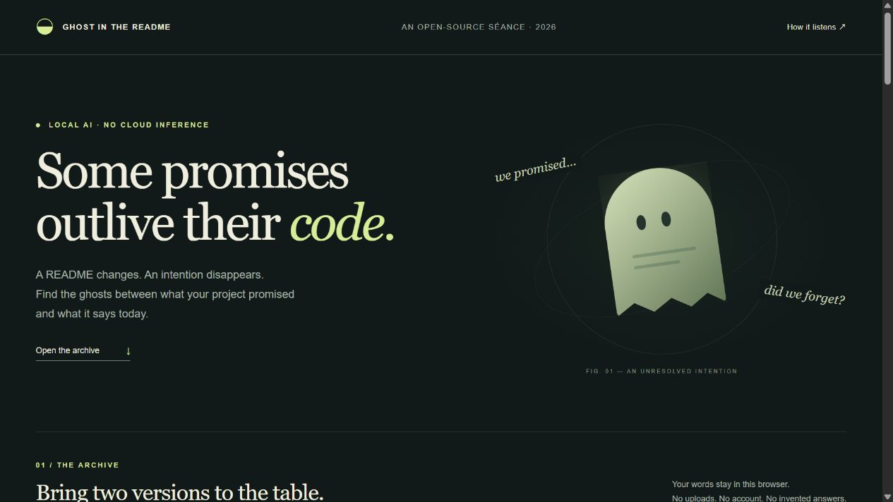

# Ghost in the README

**Some promises outlive their code.** A local semantic séance for the intentions a project leaves behind when its documentation changes.



Paste two versions of a README or project plan. An open-weight MiniLM model retrieves the closest present-day passage for every old passage. Inspect the evidence, then decide whether to keep, retire, or investigate a promise. Export a review ledger instead of leaving another unexplained deletion.

This is a new project created on **October 29, 2026 UTC / October 30 Beijing time**, during the DEV Hacktoberfest Week 4 creation window. Contest submission status is separate from publishing this source repository.

## Run the live app

Requires Node.js 20.19+ or 22.12+; tested with Node **24.19.0** on Windows x64. Use a modern browser with WebAssembly and Web Workers. No API key, GPU, paid service, or model account is required.

```sh
npm ci
npm run prepare:offline
npm run dev
```

Open `http://127.0.0.1:4317`. Stop the server with Ctrl+C when finished.

The first two commands need internet access to download dependencies and **22.81 MiB of model files**. `prepare:offline` pins the model revision, verifies cached file hashes, and copies the WebAssembly runtime locally. After preparation, the app runs from a local HTTP server with remote model loading disabled. It does not run by double-clicking `index.html`.

For an optimized local build:

```sh
npm run build
node scripts/serve.mjs
```

The included production preview binds only to loopback and stops automatically after 15 minutes. It is a preview utility, not an internet hosting server. It can also be stopped with Ctrl+C. Source archives intentionally omit dependencies, generated builds, and model weights; the prepared working folder retains them for this machine.

## Use it without a browser

```sh
node scripts/cli.mjs examples/lantern-before.md examples/lantern-after.md review-output
```

The CLI accepts your own two text or Markdown files and writes `review.json` and `review.md`. All findings start as **unreviewed**. The same parsing, similarity, warning, and report code powers both interfaces.

## A two-minute tour

1. Run **The Lantern archive**, an original fictional oral-history app. Its old version promises local storage, text export, keyboard access, speaker names, semantic search, and no ads.
2. Inspect the missing keyboard-access passage and the changed privacy passage. A nearest neighbor is always shown, even when it is a poor match.
3. Inspect text export: wording changes from “plain text file” to “TXT format,” but its cosine similarity is about **0.711** versus only **0.056** word overlap in the recorded run.
4. Mark keyboard access **Investigate** and leave a reason. Adjust the threshold; the note stays attached to the same source passage.
5. Export the review. The JSON includes both original documents, line numbers, alternatives, input SHA-256 fingerprints, model/runtime metadata, scores, and your notes.
6. Try **The convincing impostor**. “Works without internet” and “internet required” score about **0.764**. The app warns that negation vocabulary changed. A close echo can mean the opposite.

## What the AI actually does

```text
old prose ─┐                 ┌─ nearest current passage + alternatives
           ├─ MiniLM vectors ┤
new prose ─┘                 └─ cosine similarity + lexical baseline
                                          ↓
                             human decision + evidence ledger
```

- **Model:** `Xenova/all-MiniLM-L6-v2`, an ONNX conversion of Sentence Transformers `all-MiniLM-L6-v2`, Apache-2.0.
- **Pinned revision:** `751bff37182d3f1213fa05d7196b954e230abad9`; file hashes in `evidence/model-manifest.json`.
- **Inference:** Transformers.js 3.8.1 with ONNX Runtime; q8 weights, mean pooling, L2 normalization, 384 dimensions. Browser inference runs in a Web Worker on WASM; CLI inference runs on CPU with two intra-op threads.
- **Matching:** every old passage retrieves its nearest current passage. Exact normalized text is marked unchanged. Default heuristic thresholds: cosine below 0.42 = no close echo; 0.42–0.68 = faint echo; 0.68+ = possible echo. The upper threshold is adjustable. Scores are not probabilities.
- **Review aids:** top alternatives, similarity margin, many-to-one matches, Jaccard word overlap, and a simple negation-vocabulary warning.
- **No language generation:** the app never fabricates a missing promise or quotes a person. All displayed prose comes from the supplied documents. The warning rules and visual copy are authored code, not claimed as model output.

## Privacy and limits

No analytics, accounts, databases, remote inference, or persistent document storage. Model/runtime files are served locally. The page's content-security policy restricts network connections to its own origin. Inputs and notes remain in memory until reload; exported files contain your input, so review them before sharing.

This is an **English prose review tool**, not a source-code auditor, truth detector, or entailment model. It cannot establish whether a feature exists. A removed sentence can be a sensible editorial change. Short negation rules can both over-warn and miss contradictions; for example, “cannot remember the exact words” triggers a vocabulary warning even when the semantic-search feature is still described.

Limits per document: 24,000 characters, 80 passages, 400 characters per passage. Headings and fenced code are skipped; sentence splitting preserves original line numbers. The model truncates at 256 tokens. Keep inputs short, ordinary English prose; unusual token-heavy text can still be truncated. Quantized results can vary slightly across CPU/WASM and batch shapes. Thresholds are not calibrated or evaluated against a representative dataset.

## Verified behavior

```sh
npm test
npm run verify:ai
node scripts/record-demo.mjs
```

- **10/10 core tests**: parsing (including mixed or nested code fences), source lines, URLs/version numbers, input bounds, corrupt embeddings, contradictory wording, ambiguous/shared matches, thresholds, baseline, and report integrity.
- **5/5 synthetic retrieval sanity checks** with actual MiniLM inference: each intended paraphrase outranked an unrelated sentence by at least 0.15 cosine. This is a small sanity check, **not a benchmark accuracy claim**.
- **Browser WASM run:** 13 passages, 133 ms measured inference on the test host; input/model loading is reported separately. The exported browser report contains seven findings and one preserved review note. This is one observed run, not a performance guarantee.
- Browser verification includes successful inference, a second contradiction example, JSON and Markdown downloads, threshold changes preserving notes, empty-input validation, and a 390-pixel mobile layout without horizontal overflow. No console errors were observed during these tests.
- CPU inference was rerun with `fetch` disabled, demonstrating that the prepared local model does not need a network request for that path.
- Review regression checks also ran actual browser WASM inference with external HTTP requests blocked: notes and decisions survive repeated inference, threshold changes, cancellation, and export. Editing either document invalidates the old report and clears its reviews. See [review evidence](evidence/review-browser-after.json).

See [evidence/browser-validation.json](evidence/browser-validation.json), [evidence/inference-validation.json](evidence/inference-validation.json), and [evidence/browser-export.json](evidence/browser-export.json).

## Demo and evidence

- [Open the actual CLI recording](demo/recording.html): a self-contained replay of unedited stdout/stderr, also supplied as an Asciinema v2 `.cast` file. This is recorded output, clearly labeled, not fresh inference.
- [Animated walkthrough](demo/walkthrough.gif): an edited sequence of genuine browser screenshots with captions, not a continuous screen recording.
- [Actual browser result](evidence/browser-results.jpg) and [contradiction case](evidence/browser-negation.jpg).
- [Rendered inference evidence](evidence/inference-evidence.png): a graphic generated from saved CPU results, explicitly labeled as a data graphic rather than a screenshot.

## Project layout

| Path | Purpose |
| --- | --- |
| `src/core.mjs` | Shared parser, cosine/Jaccard comparison, warning logic, exports |
| `src/worker.mjs` | Browser-local model inference |
| `src/app.mjs`, `src/style.css`, `index.html` | Accessible review interface and original CSS illustration |
| `scripts/cli.mjs` | Live command-line review for any two input files |
| `scripts/prepare-offline.mjs`, `model-lock.json` | Pinned model acquisition and local runtime preparation |
| `tests/`, `evidence/` | Meaningful tests, actual results, screenshots, provenance |
| `demo/` | Actual terminal recording and screenshot walkthrough |

## Originality, license, and AI assistance

The application, visual design, fictional examples, and prose were created for this challenge. No prior application was copied or repackaged. Original project material is MIT licensed. The pretrained model and dependencies remain under their respective licenses; see [THIRD_PARTY.md](THIRD_PARTY.md).

AI assistance disclosure: Codex assisted with ideation, implementation, tests, verification, and drafting. The runtime AI is the explicitly credited, locally executed MiniLM embedding model. No fabricated user study, testimonial, leaderboard score, or claim of a model trained here is included. No partner prize category is claimed. No commits were made after the contest deadline; any later changes must be dated here before publication.
